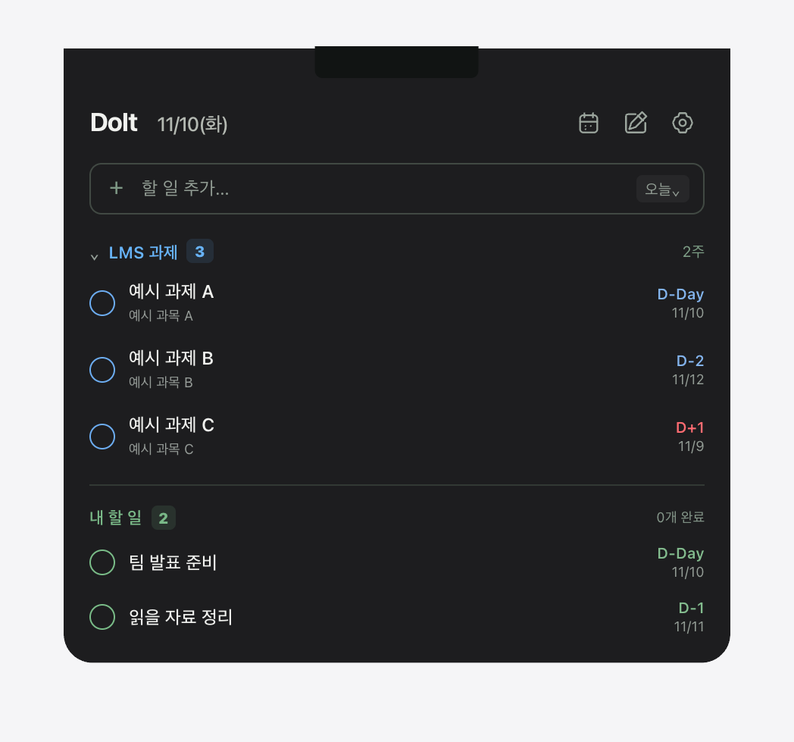
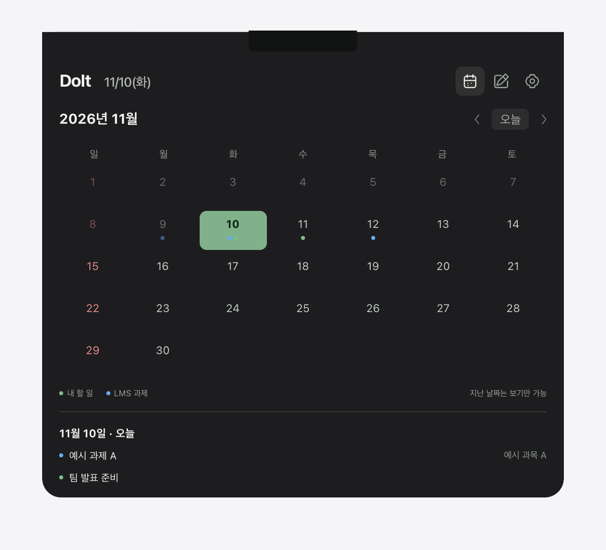
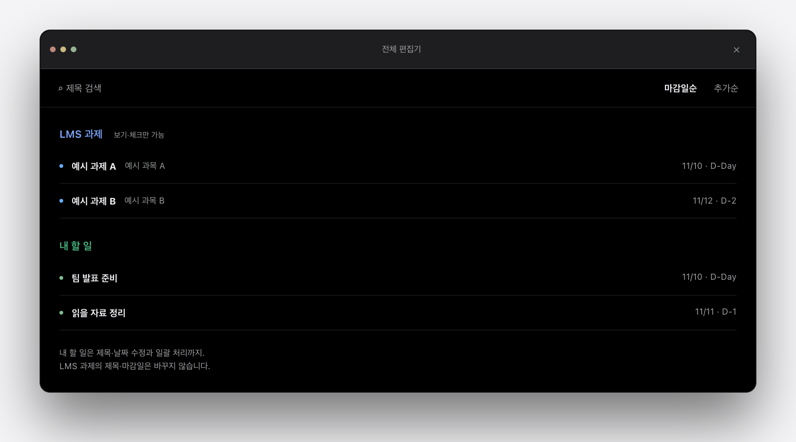

# DoIt

노치에 마우스를 대면, 할 일과 LMS 과제를 한눈에.

**[DoIt 소개 페이지 →](https://prestige-kim.github.io/DoIt/)** · 현재 게시 준비 중

소개 페이지와 다운로드는 아직 열리지 않았습니다. 아래 이미지는 허구 데이터로 만든 체험 화면입니다.

## 화면은 그대로,<br>할 일은 바로

작업 도중 할 일을 추가하기 위해 화면을 넘기는 대신,<br>어느 화면에서든 노치로 마우스만 옮기세요.

<p align="center">
  <a href="https://prestige-kim.github.io/DoIt/">
    
  </a>
</p>

## 노치에서 바로 확인

하던 작업을 떠나지 않고 할 일을 추가하고 완료하세요. LMS 캘린더 피드의 과제와 마감일도 함께 확인할 수 있습니다. 노치가 없는 주 디스플레이에는 가상 노치를 표시합니다.

## 마감일은 달력에서

날짜별 할 일과 과제를 모아 보고, 다가오는 마감을 정리하세요.

<p align="center">
  
</p>

## 할 일은 한 번에 관리

전체 편집기에서 내 할 일의 제목·마감일을 바꾸고, 검색하거나 여러 항목을 함께 처리하세요. LMS 과제는 보기와 완료 체크만 가능합니다.

<p align="center">
  
</p>

마감 당일에는 노치 알림으로 알려줍니다. 앱이 종료된 동안에는 macOS 알림을 사용하며 알림 권한이 필요합니다. 지난 기록은 자동으로 지우지 않고, 사용자가 확인한 뒤 정리합니다.

## 사용하기 전에

**Mac 전용 · macOS 14 이상.** Apple Silicon은 실사용을 확인했습니다. Intel은 universal 빌드만 확인했고 실사용은 아직 확인 중입니다.

**현재 다운로드 준비 중입니다.** 배포 파일이 제공되면 압축을 풀고 → `DoIt.app`을 응용 프로그램으로 옮기고 → 실행하세요. 자체 서명 앱이라 macOS가 차단할 수 있습니다. 이때 시스템 설정 → 개인정보 보호 및 보안에서 ‘그래도 열기’를 확인하세요. 설치를 위해 인증서나 개발자 키를 가져오거나 터미널을 사용할 필요는 없습니다.

<details>
<summary>설치·업데이트 확인 범위</summary>

기존 설치 실측에서는 관리자 암호를 1번 입력했으며 첫 실행에 약 30초가 걸릴 수 있었습니다. macOS 버전·보안 설정에 따라 화면·순서·인증 횟수는 달라질 수 있습니다.

업데이트는 새 버전을 확인한 뒤 사용자가 설치를 선택합니다. 자동 다운로드·자동 설치는 제공하지 않습니다. 현재 일반 빌드는 ‘업데이트 준비 중’이며 확인 요청과 배포 포장을 차단하고 있습니다. 정식 원격 업데이트·다른 맥 설치는 아직 검증하지 않았습니다.

</details>

## LMS 연결과 개인정보

현재 한동대 LMS 기준이며, 다른 학교는 미검증입니다. **학교 공식 앱이 아닙니다. LMS 원본이 기준이고 DoIt은 보조 도구입니다.** 중요한 마감은 LMS에서 직접 확인하세요.

LMS에서 발급한 개인 캘린더 피드 주소는 **DoIt 앱 설정 창에만 직접 입력**하세요. 연동은 기본으로 꺼져 있습니다. 주소는 비밀번호처럼 다루고 스크린샷·터미널·대화에 노출하지 마세요. 노출했다면 LMS에서 재발급하세요.

할 일·과제·체크 상태·기록은 각자의 맥 안에 저장됩니다. 개발자는 사용자 데이터를 수집하거나 전송받지 않습니다. LMS에는 피드 읽기(GET)만 요청하며 할 일이나 체크 상태를 보내지 않습니다. 강의자료·게시글·첨부파일 접근이나 LMS 화면 크롤링, LMS 데이터의 외부 서버·AI 전송은 하지 않습니다.

피드 주소는 본인 계정 전용 파일에 저장합니다(파일 권한 600·폴더 권한 700, Time Machine 백업 제외). 같은 계정의 다른 프로그램까지 차단하는 저장소는 아닙니다. 업데이트 확인·다운로드는 GitHub와 통신하며 IP 등 일반 HTTP 정보가 전달될 수 있습니다.

## 라이선스

[MIT License](LICENSE) · © 2026 prestige-kim · [외부 코드·자산 고지](THIRD_PARTY_NOTICES.md)

<details>
<summary>개발자 안내</summary>

### 로컬 미리보기

`python3 -m http.server 4173 --bind 127.0.0.1 --directory site` 실행 후 `http://127.0.0.1:4173/`을 엽니다. 종료는 Ctrl+C입니다. 웹 체험에는 실제 LMS 연결·입력 수집·외부 요청이 없습니다. 이미지도 허구 데이터만 담고 있으며 Apple 배경·메뉴바를 포함하지 않습니다.

고지를 바꾸면 `python3 scripts/sync-site-notices.py`로 페이지 사본을 맞춥니다. 릴리스 준비·검증·발행 순서는 [릴리스 운영 안내](docs/RELEASING.md)를 참고하세요. Issues도 현재 공개 준비 중입니다.

### 업데이트 준비 상태

Sparkle 2.10.1을 사용합니다. 메뉴·설정 일반의 ‘업데이트 확인…’과 ‘자동으로 업데이트 확인’을 제공하며 자동 확인은 기본 켬·약 하루 간격입니다. 현재 appcast는 `https://prestige-kim.github.io/DoIt/appcast.xml`로 확정했지만 미게시 상태입니다.

번들 `DoItDistributionEnabled=false`로 업데이트 요청 시작·배포 zip/릴리스를 차단합니다. 실행 인자·환경·사용자 설정으로 해제할 수 없습니다. 정식 gate는 별도 사용자 발행 승인 후에만 바꿉니다. 로컬 시험용 구성은 정식 배포와 분리되어 있습니다.

Sparkle 로컬 8→9 업데이트와 일반 Release 9→10 복귀에서 추가 인증 창 0번·알림 권한 유지를 사용자 확인했습니다. 정식 원격 배포·다운로드·다른 맥 설치의 검증 결과는 아닙니다. 주소 확정은 게시 완료를 뜻하지 않습니다.

### 소스 빌드


Xcode와 XcodeGen이 필요합니다. iCloud 동기화 폴더 밖에서 작업하는 것을 권장합니다. 기본 빌드는 `DoIt Self Signing` 코드 서명 인증서를 사용합니다. 개발용 인증서는 각 개발자가 직접 준비하며 배포자의 인증서·개인 키를 공유하지 않습니다.

```sh
xcodegen generate
xcodebuild -project DoIt.xcodeproj -scheme DoIt -configuration Debug -derivedDataPath build build
scripts/test.sh
```

테스트는 설치본과 충돌하지 않도록 `scripts/test.sh`를 사용합니다. 실행 중인 DoIt을 종료하고 테스트 후 기존 설치본을 다시 켭니다.

인증서 없이 개발용으로만 빌드할 때는 위 `xcodebuild` 명령 끝에 `CODE_SIGN_IDENTITY=-`를 붙이는 임시 서명을 선택할 수 있습니다. 설치·배포용이 아니며 설치본과의 충돌, 기존 키체인 접근·알림 권한에 영향을 줄 수 있습니다.

### 공개 파일 내보내기

`scripts/export-public.sh <대상폴더>`는 실행 시점 main에 커밋된 공개 대상만 검사해 복사합니다. 아직 main에 필수 파일이 없으면 병합 전임을 안내하고 실패합니다. macOS의 Xcode Command Line Tools가 제공하는 `/usr/bin/python3`와 Git을 사용하며 외부 패키지를 설치하지 않습니다.

최초 대상은 비어 있어야 합니다(기존 `.git`만 있는 폴더 허용). 재실행은 상태 파일에 기록된 관리 파일만 갱신하고 main에서 사라진 관리 파일만 삭제합니다. 대상 `.git`과 관리 밖 파일은 보존하며 관리 밖 파일과 충돌하면 중단합니다. `.doit-export-state.json`은 로컬 관리 정보로 커밋하지 않습니다. 임시 staging의 main 파일과 대상에 보존할 관리 밖 일반 파일의 경로·비밀 검사가 모두 통과해야 반영합니다. 위험한 관리 밖 파일·링크·특수 파일은 삭제하지 않고 차단하므로 공개 대상에서 직접 정리한 뒤 다시 실행하세요. 대상 최상위 `.git`은 열거나 순회하지 않습니다. 자동 검사 통과가 비밀이 전혀 없음을 보장하지는 않으므로 실제 공개 전 별도 검토가 필요합니다. 네트워크 접속이나 GitHub 작업은 수행하지 않습니다.

</details>
